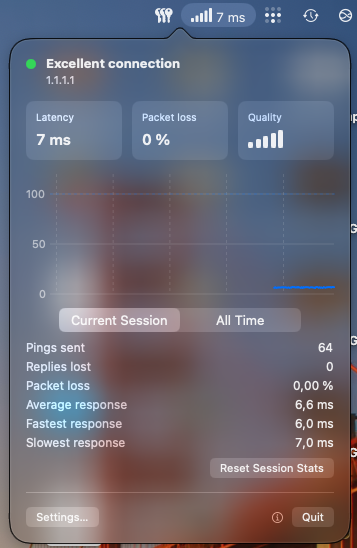
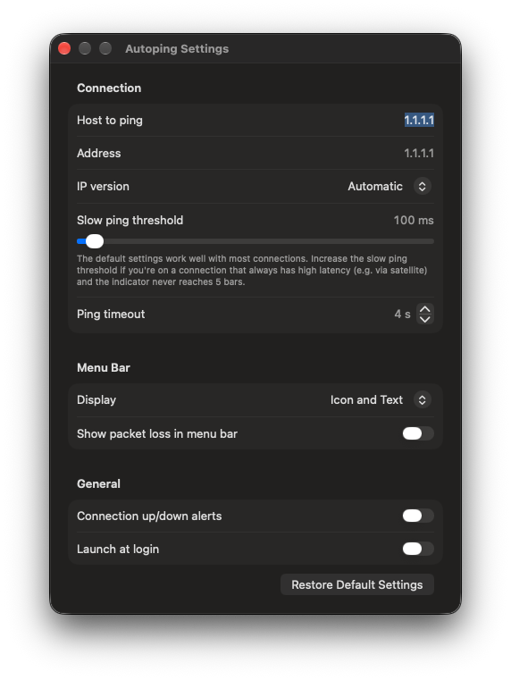

# Autoping

A tiny menu bar app for macOS that pings a host every second and shows the quality of
your internet connection as signal bars, with the latest ping time next to it.

Autoping is a modern rebuild of [autoping](https://www.memset.com) 1.02 by Memset Ltd.
(2013). The original is Intel-only, is no longer maintained and stops working once
macOS drops Rosetta 2. This version keeps its behavior and adds what it was missing.

<p align="center">
  
  &nbsp;&nbsp;
  
</p>

## Features

- **Signal bars at a glance** – one to five bars, computed exactly like the original
  (see [How the bars are calculated](#how-the-bars-are-calculated)).
- **Details on click** – status, latency, packet loss, a live chart of the last five
  minutes with lost pings marked, and session and all-time statistics.
- **IPv4 and IPv6** – chosen automatically, or forced to one of them.
- **Alerts** when the connection goes down and when it comes back.
- **No false alarms** – pauses while the Mac sleeps, and restarts with a fresh DNS
  lookup when the network changes (Wi-Fi, Ethernet, VPN).
- **Clear errors** – unknown host, no route, no network.
- Icon, text or both in the menu bar; optional packet loss text; launch at login;
  light and dark mode; English and German.

## Requirements

macOS 14 Sonoma or later on Apple Silicon.

## Building

Autoping is a Swift package. The Xcode Command Line Tools are enough:

```bash
xcode-select --install
Scripts/build.sh --install
```

This builds `dist/Autoping.app`, installs it to `/Applications` and launches it.
`Scripts/build.sh` only builds, `Scripts/test.sh` runs the unit tests.

The app is signed ad hoc, so build it on the Mac you want to run it on – a copied
build is blocked by Gatekeeper.

You can also open `Package.swift` in Xcode for development. Xcode runs the app outside
an app bundle, so notifications and launch at login are not available there.

## Usage

Click the menu bar item for details, right-click it for Settings, About and Quit.
In Settings you choose the host (default `1.1.1.1`), the IP version, the latency at
which a ping counts as slow (default 100 ms) and the timeout after which it counts as
lost (default 4 s).

## How the bars are calculated

The algorithm was recovered from the original binary and is implemented in
`Sources/AutopingCore/ConnectionScorer.swift`, covered by unit tests:

1. Every ping of the last 30 seconds gets a score: 1 up to the slow threshold, then
   falling linearly to 0 over the next 900 ms (and further, down to −2.5). A ping
   without a reply within the timeout scores −2.5.
2. The scores are averaged, each ping weighted 1.2 times as much as the one before it,
   so recent pings count most.
3. The average, clamped to 0…1, maps to one to five bars.

If no reply arrives for the timeout plus four seconds, the connection is reported as
down and the pinger restarts.

## Troubleshooting

```bash
log stream --predicate 'subsystem == "de.jonathanlang.Autoping"'
```

Settings are stored under `de.jonathanlang.Autoping` in the user defaults, statistics in
`~/Library/Application Support/de.jonathanlang.Autoping/stats.json`.

## Credits

Original autoping by Memset Ltd. (Richard West, original concept by Kate Craig-Wood).
This rebuild is an independent project and not affiliated with Memset.

## License

MIT – see [LICENSE](LICENSE).
